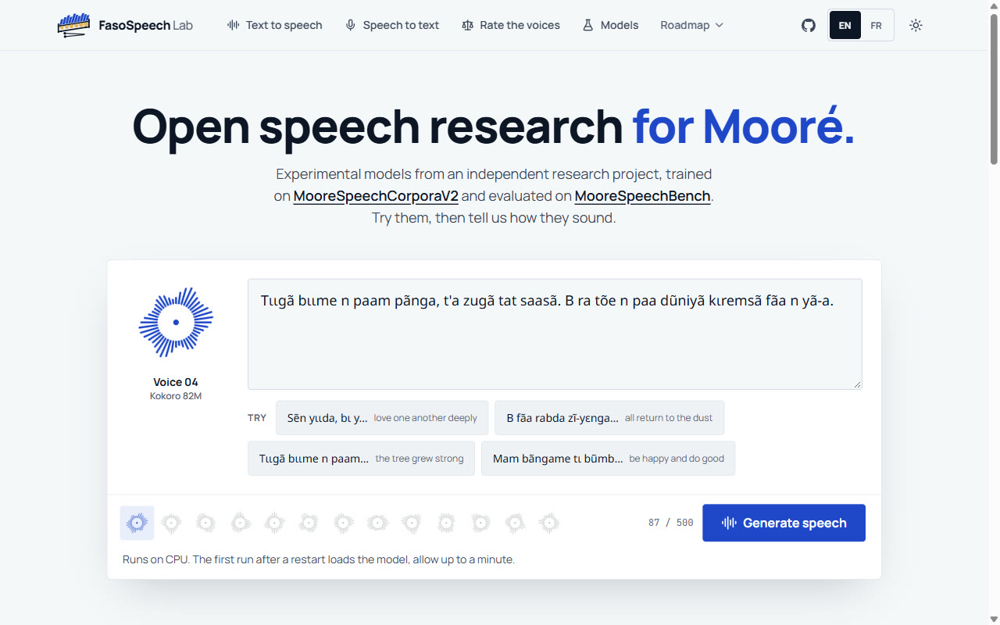
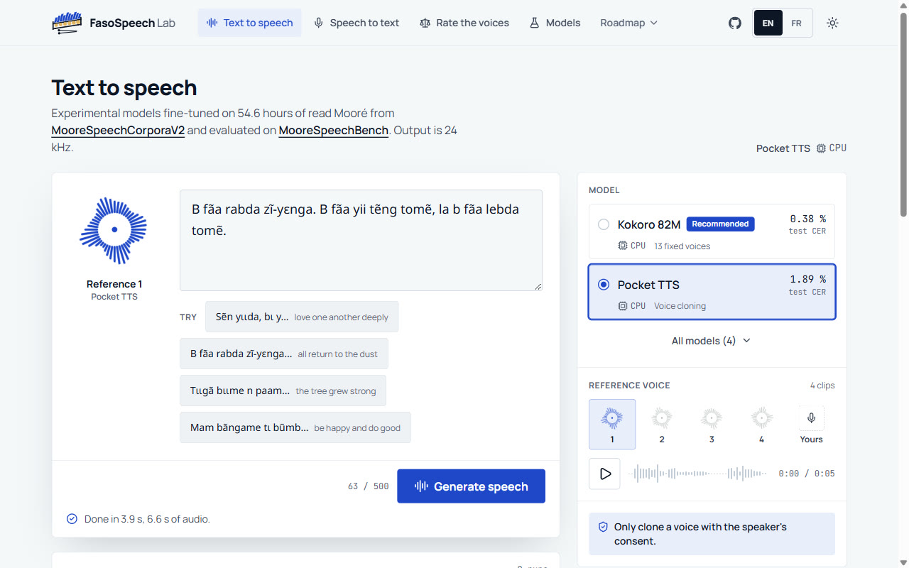
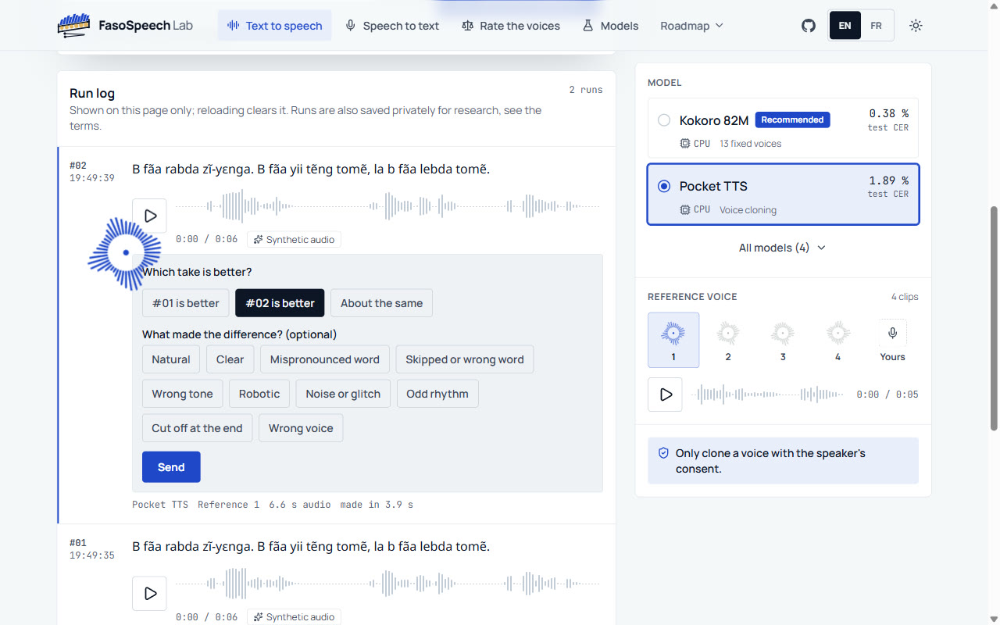
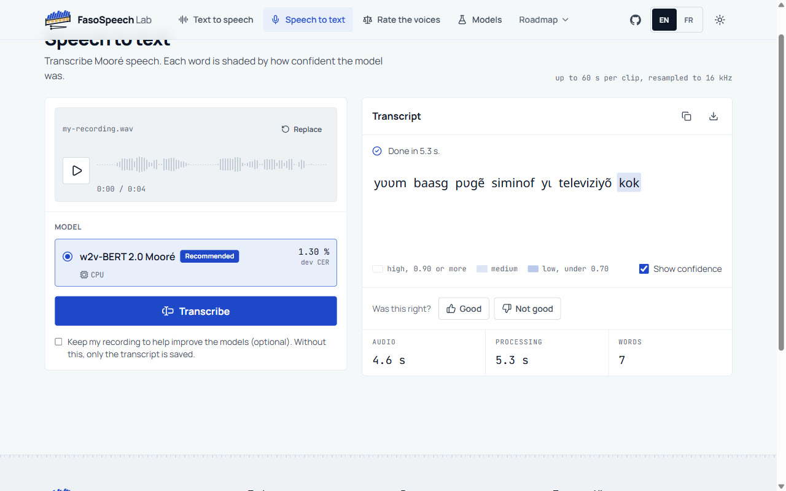
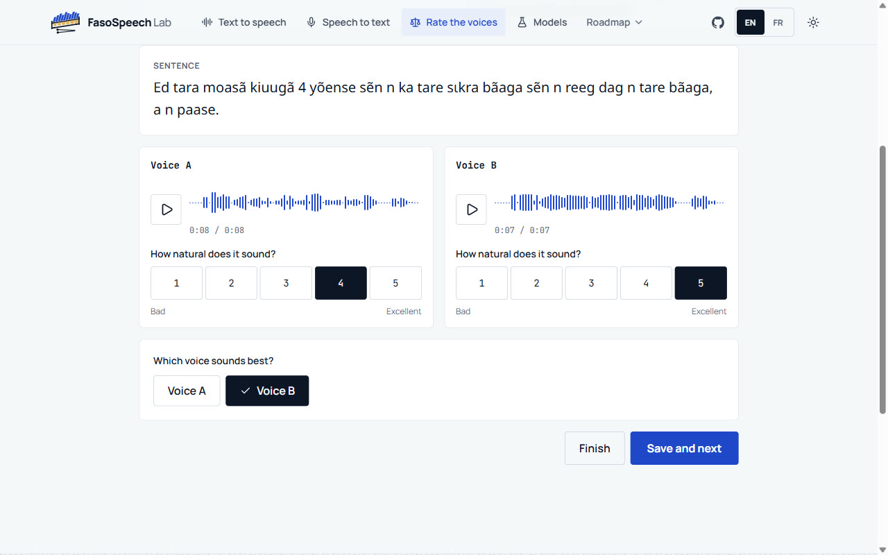
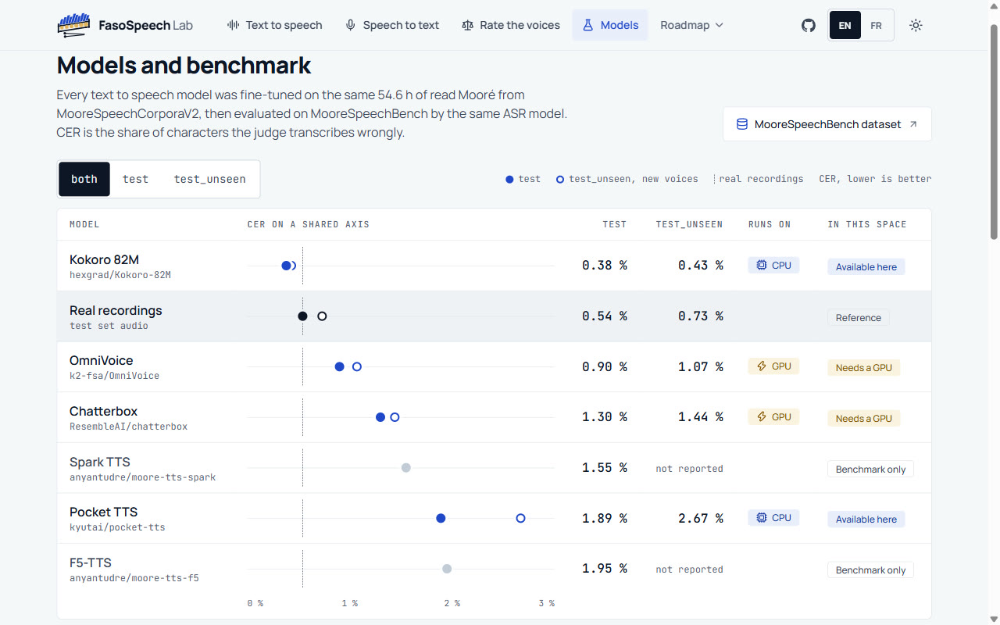
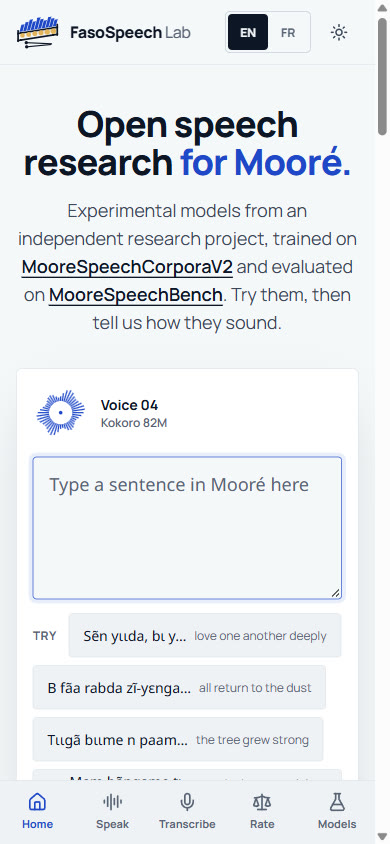
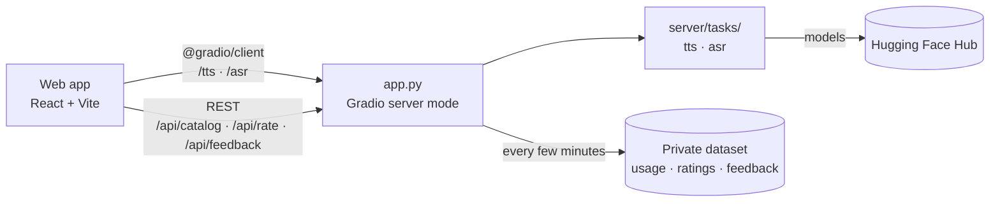

<p align="center">
  <picture>
    <source media="(prefers-color-scheme: dark)" srcset="assets/brand/fsl-horizontal-dark.svg">
    
  </picture>
</p>

<p align="center">
  An open research lab for Mooré speech models.<br>
  <a href="https://github.com/anyantudre/faso-speech-lab/actions/workflows/deploy.yml"></a>
  <a href="https://huggingface.co/spaces/anyantudre/faso-speech-lab"></a>
  
  
  <a href="LICENSE"></a>
</p>

FasoSpeech Lab is where I try out the speech models I train for Mooré, the most widely spoken language of Burkina Faso, and where anyone can try them too. You can type Mooré and hear it read aloud, transcribe a Mooré recording, and, if you speak the language, rate the voices of several models in a blind test that feeds a research paper.

> [!NOTE]
> It is an independent, non-commercial research project, still in progress, built on openly available data. The text-to-speech models are trained on [MooreSpeechCorporaV2](https://huggingface.co/datasets/anyantudre/MooreSpeechCorporaV2) and evaluated on [MooreSpeechBench](https://huggingface.co/datasets/anyantudre/MooreSpeechBench); both datasets were built with [FasoSpeechCorpora](https://github.com/anyantudre/FasoSpeechCorpora).

> [!IMPORTANT]
> **For mature work on the languages of Burkina Faso, see these two initiatives.**
>
> - **[GO AI Corporation](https://goaicorporation.org)**: production-grade models, commercial licenses, APIs and collaborations to integrate models into your products.
> - **[BurkimbIA](https://huggingface.co/burkimbia)**: a community initiative working on the languages of Burkina Faso.

## Demo

https://github.com/user-attachments/assets/beadc1a6-be88-48bf-9e9c-e0e4bcbe87fa

## Features

- Text to speech with four fine-tuned models: Kokoro with 13 voices of the training readers, and Pocket TTS, OmniVoice and Chatterbox, which clone a voice from a short clip. Output is 24 kHz.
- Speech to text: upload or record up to 60 s of Mooré, and each word of the transcript is shaded by how confident the model was.
- A blind listening test for Mooré speakers, "Rate the voices": the same sentence from two or three models, names hidden, a 1 to 5 score for each and a pick for the best one.
- Feedback for training: every output can be marked good or not good, with reasons. "Another take" generates the same sentence with a new seed and asks which take is better, which gives preference pairs for tuning. Corrected transcripts are kept for review.
- A models page with the score of every model on MooreSpeechBench, next to real recordings.
- English and French interface, light and dark themes, and a layout that works on phones.

## Screenshots

| Home | Text to speech |
|---|---|
|  |  |
| **Another take** | **Speech to text** |
|  |  |
| **Rate the voices** | **Models and benchmark** |
|  |  |

<p align="center"></p>

## Models

| Task | Model | MooreSpeechBench test CER | Runs on |
|---|---|---|---|
| Text to speech | [Kokoro 82M](https://huggingface.co/anyantudre/moore-tts-kokoro), 13 voices | 0.38 % | CPU |
| Text to speech | [OmniVoice](https://huggingface.co/anyantudre/moore-tts-omnivoice), voice cloning | 0.90 % | GPU |
| Text to speech | [Chatterbox](https://huggingface.co/anyantudre/moore-tts-chatterbox), voice cloning | 1.30 % | GPU |
| Text to speech | [Pocket TTS](https://huggingface.co/anyantudre/moore-tts-pocket), voice cloning | 1.89 % | CPU |
| Speech to text | [w2v-BERT 2.0 Mooré](https://huggingface.co/anyantudre/mos-w2v-bert-2.0-bench) | 1.30 % (dev) | CPU |

CER is the share of characters an ASR judge gets wrong when it transcribes the synthetic speech; real recordings score 0.54 % on the same test. A score below that of real speech means the judge reads the clip easily, not that it sounds more natural than a person, which is why the rating test exists. The models are released under CC BY-NC 4.0, and access is granted on request on Hugging Face.

## How it works



- `app.py` runs Gradio in server mode. Model calls are queued Gradio endpoints, a few small REST routes serve the catalog, the rating test and feedback, and the built web app is served at `/`.
- `server/tasks/` has one package per task. A task registers itself and its models in `server/registry.py`, and each model has its own engine file. Adding a task means a new package, an endpoint in `app.py` and a page in `web/src/tasks.ts`.
- `web/` is a Vite, React 19 and Tailwind 4 app with a small set of shared components (composer, player, recorder, feedback).
- `scripts/deploy.py` uploads the server and the built app to the Space; `scripts/stimuli.py` publishes the clips of the rating test.

### What the lab records

Runs, ratings and feedback go to one private Hugging Face dataset that only I can read, in separate folders: `usage/` (text, output and settings of each run, with an automatic CER from the ASR judge), `ratings/`, `participants/` and `feedback/`. A visitor's own voice, recorded for transcription or cloning, is only kept if they tick the box that allows it. Volunteers of the rating test give their name and e-mail once; these are stored apart from their answers, which carry only a random id, and results are only published as averages.

## Run it locally

Tested on Windows 11 with Python 3.12 and Node.js 22.

```bash
git clone https://github.com/anyantudre/faso-speech-lab
cd faso-speech-lab
python -m venv .venv
.venv\Scripts\activate          # macOS/Linux: source .venv/bin/activate
pip install gradio==6.31.0 -r requirements.txt
cd web && npm ci && npm run build && cd ..
```

The models are gated, so request access on their Hugging Face pages and set a read token before you start:

```bash
set HF_TOKEN=hf_...             # macOS/Linux: export HF_TOKEN=hf_...
python app.py
```

Then open http://localhost:7860. The first run of each model downloads and loads it, which takes a minute or two. OmniVoice and Chatterbox only run on a GPU; on a CPU the app shows their recorded samples instead. For frontend work, run `npm run dev` in `web/` while `app.py` runs; Vite forwards the API calls to port 7860.

Tests and linting:

```bash
pytest
ruff check .
cd web && npm run lint
```

## Deployment

Every push to `main` runs the tests, builds the web app and uploads it to the Space ([deploy.yml](.github/workflows/deploy.yml)). The Space runs on ZeroGPU: all models load onto the GPU when it starts, and each request borrows a GPU for a few seconds. The repository needs an `HF_TOKEN` secret that can write to the Space, and the Space needs its own `HF_TOKEN` secret that can read the models and write to the private dataset.

## Citation

The paper is in preparation. Until it is out, please cite the software. GitHub's "Cite this repository" button gives the same reference from [CITATION.cff](CITATION.cff).

```bibtex
@misc{nyantudre2026moore,
  author = {NYANTUDRE, Wendyell{\'e} A. Alban},
  title  = {Speech Synthesis and Recognition for Moor{\'e}},
  year   = {2026},
  note   = {In preparation},
  url    = {https://github.com/anyantudre/faso-speech-lab}
}
```

## Licence

The code is under the [Apache License 2.0](LICENSE). The models keep their own licence, CC BY-NC 4.0, so anything made with them stays non-commercial. Generated audio is synthetic and the app does not let you download it. Never clone someone's voice without their consent.

## Résumé en français

FasoSpeech Lab est le laboratoire où j'essaie les modèles de parole que j'entraîne pour le mooré, et où chacun peut les essayer aussi : synthèse vocale, transcription et un test d'écoute à l'aveugle pour les locuteurs du mooré, dont les notes servent à un article de recherche. C'est un projet de recherche indépendant et non commercial, encore en cours, construit sur des données librement accessibles. Pour des modèles prêts pour la production, des licences commerciales, des API et des collaborations pour intégrer des modèles à vos produits, voir GO AI Corporation ; pour une initiative communautaire sur les langues du Burkina Faso, voir BurkimbIA.

## Contact

[Wendyellé A. Alban NYANTUDRE](https://anyantudre.github.io/), nyantudrealban@gmail.com
